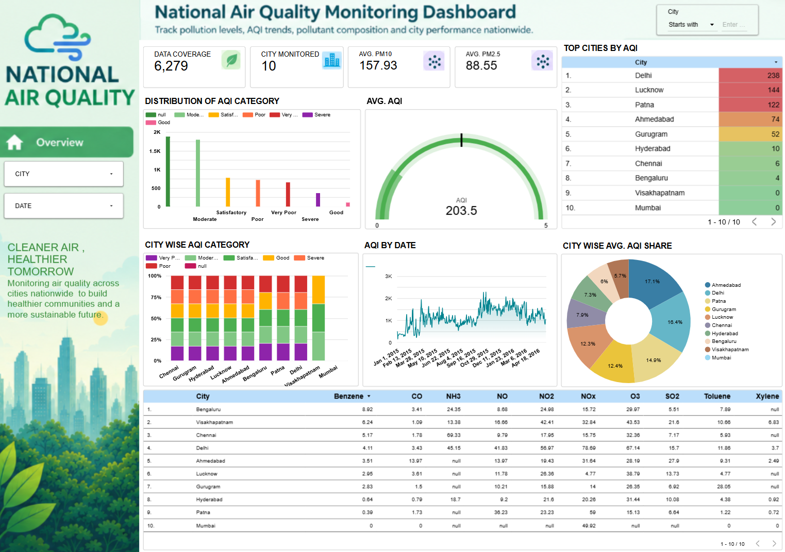

# 04 · Report

EXECUTIVE OVERVIEW DASHBOARD :

The Executive Overview dashboard provides a high-level summary of National Air Quality monitoring across ten cities . It highlights significant differences in air quality across cities , AQI by date, overall severity , average AQI and chemical and pollutant composition through interactive visualization .

DASHBOARD PREVIEW :

